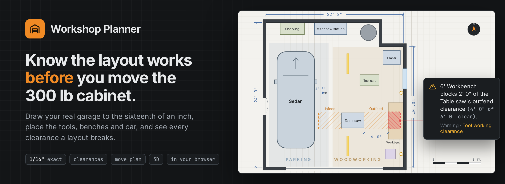
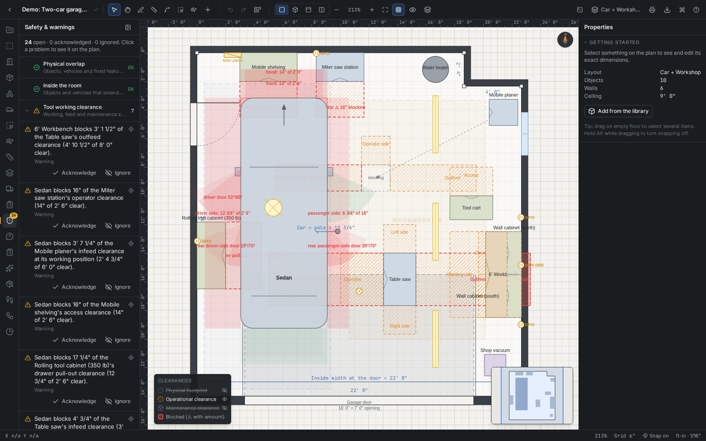
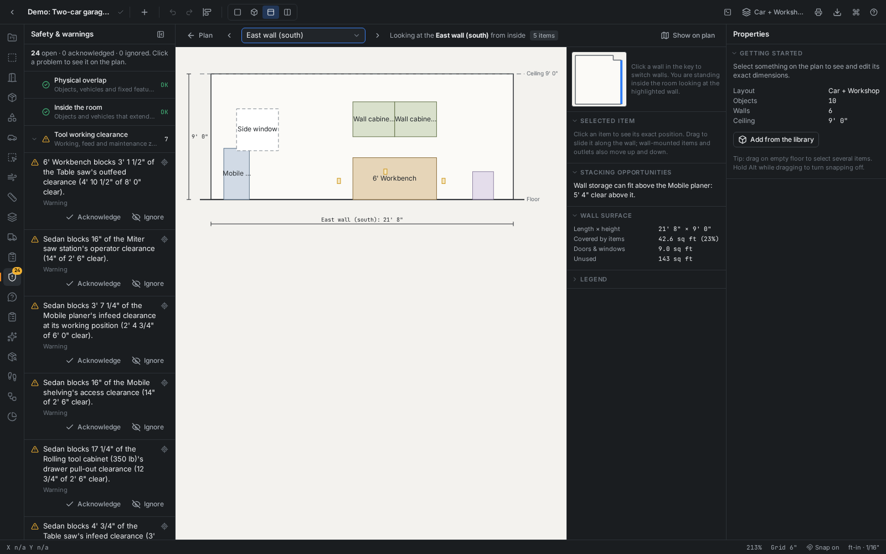
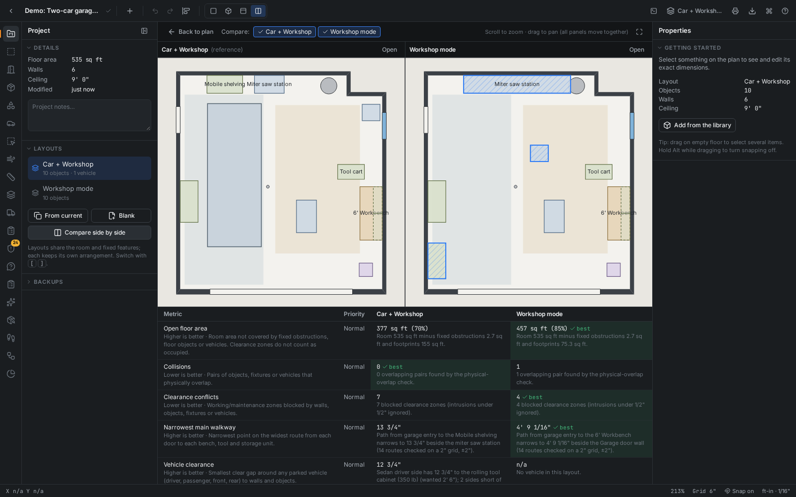
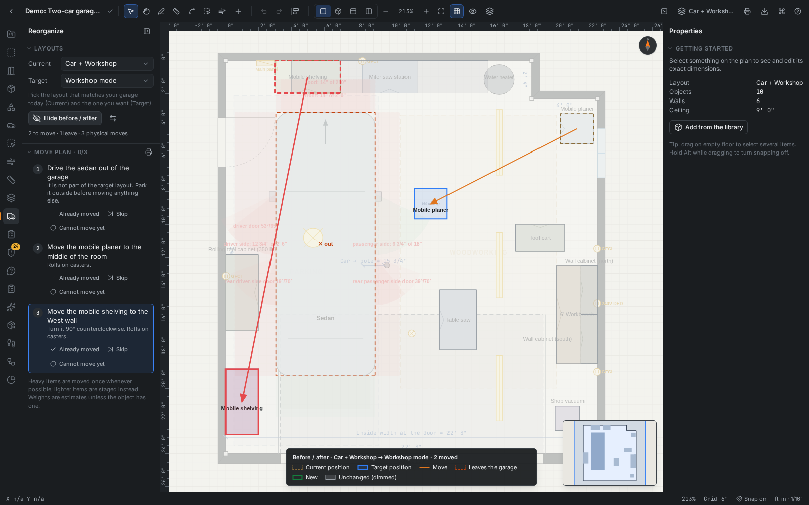
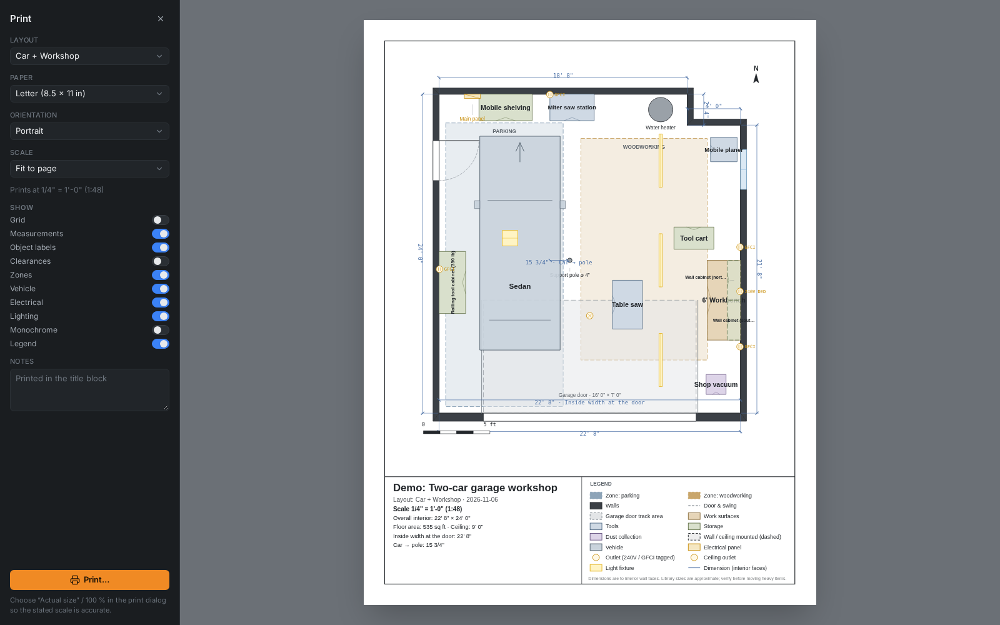
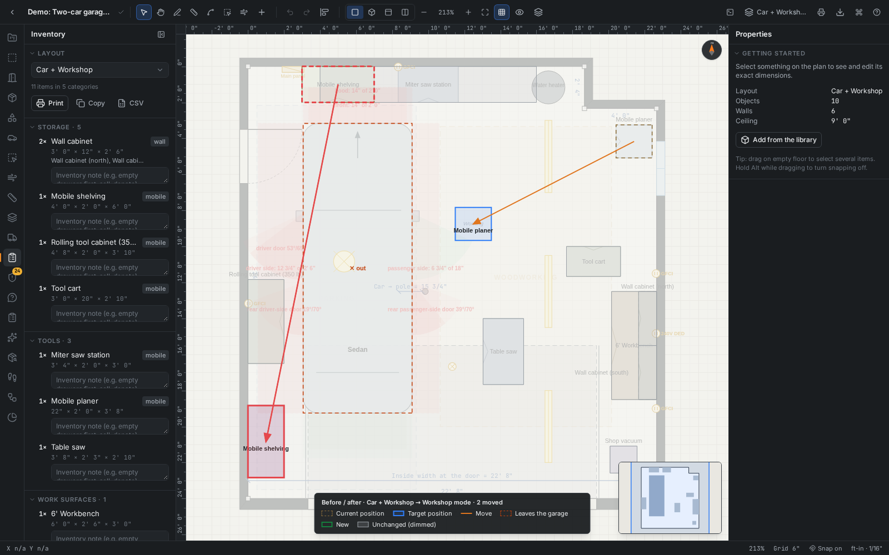
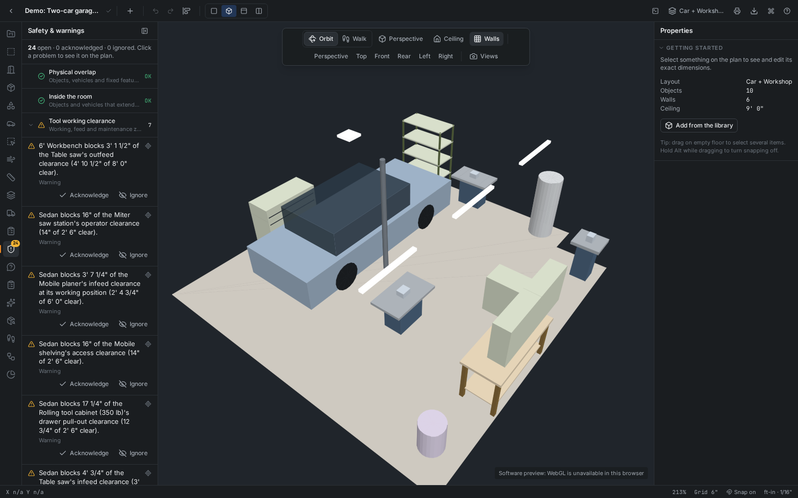
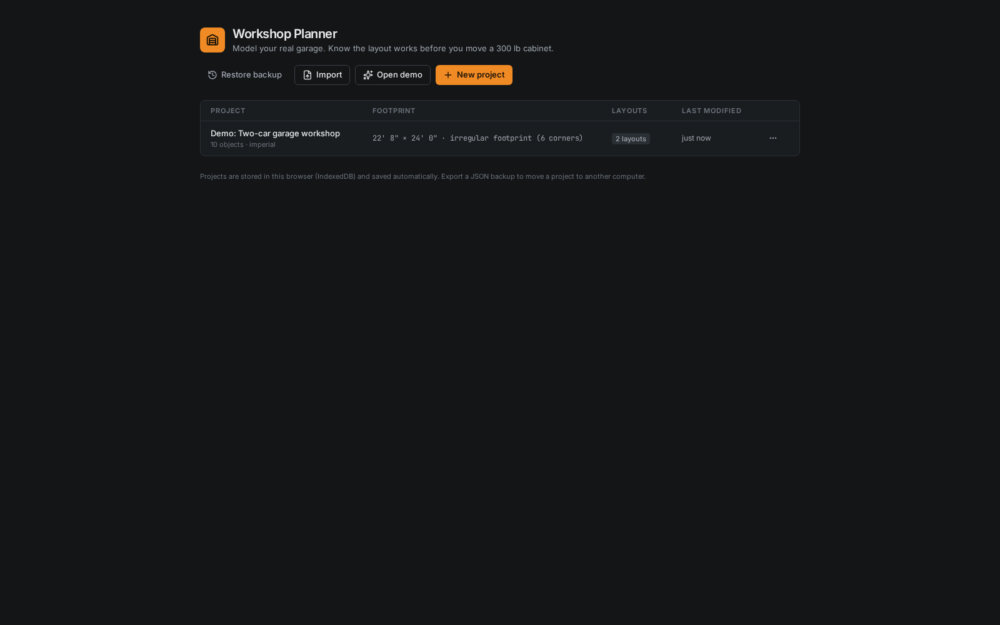

# Workshop Planner

<p align="center">
  
</p>

<p align="center">
  <a href="https://github.com/jameskbb/workshop-planner/actions/workflows/ci.yml"></a>
  <a href="LICENSE"></a>
  <a href="https://jameskbb.github.io/workshop-planner/"></a>
  <a href="package.json"></a>
  <a href="package.json"></a>
  <a href="#your-projects-stay-in-your-browser"></a>
</p>

Workshop Planner is a browser app for trying a garage or shop layout on paper first. Draw the room to the sixteenth of an inch, place the tools, benches, storage and car, and it tells you every clearance the layout breaks, and by how much. When a layout holds up, it gives you the order to move things in.

**[Open Workshop Planner](https://jameskbb.github.io/workshop-planner/) and click Open demo.** You get a furnished two-car garage with two layouts to poke at. Nothing to install and no account; projects are saved in your own browser.


*The demo garage. Each tool carries its working clearances; the panel on the left lists every one that is blocked, by how much, and by what.*

## Why plan it first

A two-car garage with a support pole in the wrong place, a table saw, a planer, a 350 lb rolling tool cabinet and a car that still has to open its doors. Rearranging it is an afternoon of lifting, and the usual way to learn that the bench now blocks the saw's outfeed is to move everything and look. Graph paper and a tape measure work until the room stops being a rectangle and the clearances start to overlap.

Here the checking is arithmetic on your measurements. A warning reads "6' Workbench blocks 3' 1 1/2" of the Table saw's outfeed clearance (4' 10 1/2" of 8' 0" clear)", and clicking it shows the spot on the plan.

## From tape measure to moving day

### 1. Measure the room

- Draw walls by clicking corners (live length and angle readout, 45° magnet) or by typing lengths and bearings. `21' 6"`, `4 ft 6 in` and `1372 mm` are all accepted, and every spelling of a length resolves to the same stored value.
- Start from a rectangle, L, T, two-car or three-car template, or from the 8-step New Project wizard (name, units, room shape, ceiling, garage doors, obstructions, vehicle).
- Edit any wall's length, thickness, height, angle, name and material; drag corners and walls; lock length, angle, horizontal, vertical, parallel and perpendicular. An edit that would make the walls cross each other is refused with a plain explanation.
- Add what is fixed: doors with swing arcs, garage doors (opening, tracks and overhead band, open or closed), windows, support poles with their exact diameter, water heaters, stairs and beams; then outlets (120/240 V, GFCI, circuits), panels and lights.

### 2. Place the shop

- 54 built-in objects (benches, saws, planers, cabinets, shelving, carts and more) plus 7 vehicle types. Each has default size, weight, working clearances, electrical needs, dust ports and states such as a miter station with its wings open. The defaults are typical values, marked approximate. Make custom objects and saved groups for your own tools.
- Editing works like a drawing program: snapping to walls, corners, edges and centers with guides; rotate freely or by 15°, 45° or 90°; resize, align, distribute, group, lock, hide, copy and paste (also into another layout), nudge; keyboard shortcuts, context menus, a `Ctrl/⌘+K` command palette and 200 steps of undo.
- Type exact values anywhere (X, Y, rotation, size, elevation). Measurements follow the objects they measure. Zones, layers, category colors, a monochrome drawing mode, rulers, a minimap and view presets.

### 3. Check it

- **Clearances.** Operational, maintenance and physical zones, drawn hatched; a blocked zone is reported with the blocked distance and what is left.
- **Safety and interference.** Door swings, garage-door tracks, electrical-panel access, hazards and overhead obstructions.
- **The car.** Door swing and clearance on every side, plus a simulated drive-in from the driveway.
- **Getting around.** A walkability heat map and the narrowest walkway, travel between workflow steps, outlet reach, lighting coverage and dust-collection runs.
- **The walls.** Elevations with heights, wall coverage and where storage could stack above what is already there.


*A wall elevation. The panel on the right reports what fits above the planer and how much of the wall is in use.*

### 4. Compare layouts

- A project holds several layouts. The room is shared; each layout keeps its own arrangement. Switch between them, or set two side by side with a ten-metric scorecard (open floor, collisions, clearance conflicts, narrowest walkway, vehicle clearance and more) weighted by priorities you set.
- The layout assistant proposes Parking Priority, Workshop Priority, Balanced and Maximum Open Space alternatives (simulated annealing in a Web Worker) without touching your layout.
- Typed commands such as "move the planer against the north wall" or "rotate the table saw 90°", plus Ask the Layout, Will It Fit and What Could Fit Here. These are interpreted in the browser from the plan's geometry; no outside service is called.


*Car + Workshop against Workshop mode. Each score says how it was measured.*

### 5. Plan the move

- **Before and after.** Mark one layout Current and one Target. The plan shows current positions dashed, target positions solid, arrows for each move, items that leave or arrive, and everything unchanged dimmed.
- **Move plan.** An ordered list in plain words: "Drive the sedan out of the garage", "Move the mobile planer to the middle of the room". A spot is cleared before something moves into it. When two items need each other's spots, the one easiest to handle (lowest weight, with casters counting for much less) is staged on open floor or outside, so heavy items move once whenever possible.
- Mark steps *Already moved*, *Skip* or *Cannot move yet*, highlight a step on the plan, regenerate what is left and print a checklist.


*The move plan from Car + Workshop to Workshop mode: the car goes out first, then two moves.*

### 6. Take it to the shop

- **Print** on Letter, Legal, Tabloid, A4 or A3, portrait or landscape, fitted to the page (snapped to a standard architectural or metric scale) or at a fixed scale. Toggle grid, measurements, labels, clearances, zones, vehicle, electrical, lighting and monochrome. The sheet carries a title block, the stated scale, a scale bar and a legend.
- **Inventory** grouped by category with counts and sizes ("2 × Wall cabinet 36" × 12""), with notes per item; print it, copy it or save CSV.
- **Exports**: PNG at 96 to 600 DPI, SVG, a printable PDF, a full JSON backup, CSV inventory and DXF (walls, footprints and dimensions on separate layers, in inches or millimeters). All are drawn from the geometry, not captured from the screen.

| | |
|---|---|
|  |  |
| *A Letter sheet at 1/4" = 1'-0", with title block and legend* | *The inventory, grouped by category* |

### 7. Walk through it in 3D

Walls with their door, window and garage-door openings; simplified but recognizable benches, cabinets, tools, shelving and vehicles; wall-mounted items at their height; lights. Orbit, pan and zoom, or walk at eye height with WASD and mouse look. Hide the ceiling or walls, switch between perspective and orthographic, jump to Top, Front, Rear, Left, Right or Perspective, and save camera views.

With WebGL the view is lit and shadowed. Without it, a software renderer draws the same scene flat-shaded with the same controls, sorting faces with a BSP tree so that a support pole through a car still draws correctly. The screenshot below is the software renderer.


*The 3D view, here in the software renderer used when WebGL is unavailable.*

## What it will not tell you

- **Your tools' real sizes.** Built-in sizes and weights are typical values, marked approximate. Measure your own. Move-plan weights come from the object, from a weight in its label ("350 lb"), or from an estimate by size and category.
- **Whether the wiring passes inspection.** Electrical and lighting features are planning aids, not code-compliance checks.
- **Full CAD.** The DXF export is deliberately basic: R12 entities (lines, polylines, circles, text). Dimensions are drawn as lines and text on a `DIMENSIONS` layer, not as associative DIMENSION entities.
- **A copy anywhere else.** Projects live in one browser on one device until you export them; see the next section.

## Your projects stay in your browser

Projects are saved automatically to the browser's IndexedDB and never leave the machine: no account, no server, no sync. That also means storage is per browser and per device. A project made in one browser is not visible in another, and clearing site data deletes it. Use **Export → Project file (JSON)** to back up or move a project, and **Import** on the project list to bring it back.


*The project list, where Import, Open demo and New project live.*

---

## Run it yourself

You need **Node.js 22 or later** (24 recommended) and **pnpm 10 or later**.

```bash
git clone https://github.com/jameskbb/workshop-planner.git
cd workshop-planner
pnpm install
pnpm dev              # http://localhost:5173
```

Open the address it prints and click **Open demo**, or **New project** for the wizard.

| Command | What it does |
|---|---|
| `pnpm dev` | Vite dev server with hot reload |
| `pnpm build` | Type-check (`tsc -b`) and build to `dist/` |
| `pnpm preview` | Serve the production build |
| `pnpm typecheck` | TypeScript only |
| `pnpm lint` | ESLint (includes purity rules for the geometry, domain and analysis layers) |
| `pnpm test` | Vitest unit tests |
| `pnpm test:e2e` | Playwright end-to-end tests (starts its own dev server on :4179 and a production preview on :4178) |
| `pnpm format` | Prettier |

### Hosting your own copy

`pnpm build` produces a static `dist/` that any static host can serve; the [live app](https://jameskbb.github.io/workshop-planner/) is that build on GitHub Pages. The app routes in the URL hash and builds with a relative base, so it works from a project-site sub-path (`https://<user>.github.io/<repo>/`) with no extra configuration.

## How it is built

```
            ┌──────────────── UI (React) ─────────────────────────────────┐
            │  app shell · registries · features/<name>/register.tsx       │
            │  Konva 2D plan · SVG compare/elevation · R3F 3D (lazy)       │
            └──────────────┬───────────────────────────┬──────────────────┘
                 dispatch(AppCommand)            selectors / hooks
            ┌──────────────▼───────────┐   ┌───────────▼─────────────────┐
            │ stores/projectStore       │   │ stores/uiStore, editorStore │
            │ command bus, undo/redo,   │   │ view state, live previews   │
            │ transactions              │   └─────────────────────────────┘
            └──────────────┬───────────┘
      pure ────────────────┼───────────────────────────────────────────────
            ┌──────────────▼───────────┐   ┌─────────────────────────────┐
            │ domain/  Zod schema,      │──▶│ analysis/ analyzers +       │
            │ commands, units, resolve, │   │ metrics (warnings, scores)  │
            │ serialization+migrations  │   └──────────────┬──────────────┘
            └──────────────┬───────────┘                  │
            ┌──────────────▼──────────────────────────────▼──────────────┐
            │ geometry/  polygons, SAT collision, walls, snapping,         │
            │ clearance zones, walkability grid, vehicle + Dubins paths    │
            └──────────────────────────────────────────────────────────────┘
            persistence/  IndexedDB repository, autosave, snapshots
```

- **One canonical unit.** Every length is stored in millimeters, quantized at every parse and commit onto a lattice fine enough to hold 1/16", 1/32" and 1/64" exactly (0.000001 mm). Imperial and metric are only input/display formats, so repeated edits do not drift.
- **Pure core.** `src/geometry`, `src/domain` and `src/analysis` import no React, Konva, three.js or stores (enforced by ESLint) and are covered by unit tests. Rendering reads from them; it never computes geometry of its own.
- **Command bus.** Every change to a project is a typed, Zod-validated, serializable `AppCommand`, executed on an immer draft. That gives atomic transactions, gesture coalescing (a drag is one undo step), undo/redo, and a safe target for the natural-language command interpreter.
- **Extension registries.** Features plug in through registries (sidebar sections, inspector sections, toolbar items, canvas tools and layers, overlays, context-menu actions, palette commands, shortcuts, export formats, app views, entity adapters) from their own `features/<name>/register.tsx`, which is loaded automatically. Commands, analyzers and metrics register the same way from `commands.ts`, `analysis.ts` and `metrics.ts`. Feature data that isn't part of the core schema is stored in typed project/scenario extensions (`defineExtension`).
- **Scenarios.** Room geometry, architecture and electrical are shared project-wide. Objects, vehicles, lights, zones, measurements and relationships belong to each layout. Duplicating a layout keeps entity ids, so the same physical item can be matched across layouts; comparison, the before/after overlay and the move plan rely on that.
- **Persistence.** A `Repository` interface (so cloud sync could be added later) is implemented on IndexedDB: projects, summaries, snapshots (automatic, before-delete and manual), the global custom-object library and settings. Autosave is debounced. Loads and imports go through the same validation and migration pipeline as the portable JSON format.
- **Exports** share one vector model: `features/exports/plan/drawing.ts` turns the project into primitives in world millimeters. SVG serializes them; PNG rasterizes that SVG offscreen at the chosen DPI; PDF and print compose a to-scale sheet around it (jsPDF + svg2pdf, loaded on demand); DXF (`features/exports/dxf/`, isolated) writes the same primitives onto CAD layers.
- **3D** is a separate lazy chunk. `features/three-d/model.ts` (pure, tested) turns the project into solids; `sceneBuilder.ts` builds one three.js scene graph that both the WebGL (React Three Fiber) view and the software SVG renderer use.

The full developer guide, covering conventions, coordinate system, registries, the command bus and the editor's extension points, is in **[docs/ARCHITECTURE.md](docs/ARCHITECTURE.md)**. The product brief is in [docs/BRIEF.md](docs/BRIEF.md).

## Technology

React 19 · TypeScript 5.9 (strict) · Vite 8 · Tailwind CSS 4 with Radix-based shadcn-style components · Zustand + immer · react-konva (2D) · three.js + React Three Fiber + drei (3D) · Zod · idb (IndexedDB) · polygon-clipping · jsPDF + svg2pdf.js (PDF) · Vitest + Testing Library + fake-indexeddb · Playwright.

---

## Testing

```bash
pnpm test        # 610 unit tests
pnpm test:e2e    # Playwright suite (Chromium)
```

**Unit tests** (`*.test.ts` next to the code) cover measurement parsing and unit conversion; polygon containment, clipping and self-intersection; rotated-object collision with penetration depth; clearance zones; snapping; wall distances; walkability; vehicle geometry and entry paths; the room constraint solver; undo/redo and transactions; scenario duplication; serialization, migrations and import errors; IndexedDB persistence; analyzers and metrics; the optimizer; natural-language commands; the move planner (dependencies, cycles, staging, weights, statuses); inventory, CSV escaping, the SVG plan, the printable sheet and DXF output; and the 3D scene model.

**End-to-end tests** (`e2e/`) cover the brief's critical flows and every major feature:

| Flow | Spec |
|---|---|
| New project (wizard, Start blank) | `workflow.spec.ts` |
| Drawing a room (clicks, typed lengths, wall table) | `workflow.spec.ts` |
| Adding, dragging and exactly dimensioning objects | `workflow.spec.ts`, `editor.spec.ts` |
| Creating a scenario (layout) | `brief-flows.spec.ts`, `phase4-scenarios.spec.ts` |
| Saving / reloading | `smoke.spec.ts`, `brief-flows.spec.ts` |
| Exporting / importing JSON (plus a rejected bad file) | `brief-flows.spec.ts` |
| PNG / SVG / PDF / CSV / DXF export, print mode | `exports.spec.ts` |
| Before/after, move plan, inventory | `reorganization.spec.ts` |
| 3D view | `three-d.spec.ts` |
| Production build (chunking, persistence, lazy 3D and print) | `preview-smoke.spec.ts` |
| Clearances, vehicles, elevation, custom objects, intelligence, perf | `phase3-*`, `phase4-*`, `perf.spec.ts` |

One spec, `preview-smoke.spec.ts`, runs against the **production build** (`vite build` + `vite preview`): it uses nothing but the DOM, so bundling, chunking and `import.meta.env` regressions that only exist in the built app cannot ship unnoticed.

Chromium runs with `--disable-gpu --disable-software-rasterizer`, because GPU/SwiftShader compositing stalls `requestAnimationFrame` on some headless machines. Without WebGL, the 3D spec exercises the software renderer and asserts on the scene and camera state the view exposes in dev builds (`window.__wp3d`), not on pixels. On a machine where headless WebGL works, `WP_E2E_WEBGL=1 pnpm test:e2e` adds a `webgl` project that runs the same spec against the WebGL renderer. Local runs use at most 3 workers.

---

## Project structure

```
src/
  main.tsx                 entry: styles → <App/> (the editor, its registrations and every feature
                           are one lazy chunk, loaded when a project is opened)
  app/                     shell (toolbar, sidebars, inspector, status bar, palette), registries,
                           plan canvas + viewport math, project list / wizard / backups
  components/              UI primitives (Radix/shadcn-style), LengthInput, shell parts
  domain/                  PURE: Zod schema, commands, units, resolve, room edits, measurement,
                           serialization + migrations, extensions
  geometry/                PURE: polygons, SAT, clipping, walls, snapping, clearance, grids,
                           walkability, vehicles, Dubins paths, constraints, ray casting
  analysis/                PURE: analyzer + metric registries and core analyzers
  persistence/             IndexedDB repository, autosave, snapshots, project service
  stores/                  project store (command bus, history), UI store, editor store
  hooks/ utils/ styles/
  features/                one folder per feature, each with register.tsx (+ commands/analysis/metrics):
    editor plan room architecture objects custom-objects states layers measurements zones
    clearances safety vehicles electrical lighting dust elevation walkability workflow utilization
    scenarios optimization commands ask fitcheck warnings onboarding projects
    reorganization/        move planner (planner.ts), layout diff, before/after overlay, move-plan panel
    inventory/             inventory model + panel
    three-d/               scene model, scene builder, WebGL view, software renderer, saved cameras
    exports/               plan drawing model, SVG, sheet (PDF/print), PNG/PDF render, CSV, dxf/
    print/                 print mode + print CSS, printable documents
e2e/                       Playwright specs + helpers
docs/                      BRIEF.md, ARCHITECTURE.md, README images
```

## Project file format

Projects export as a portable, versioned JSON envelope (`*.workshop.json`) containing the whole project: room, fixed features, electrical, embedded object definitions, all layouts, saved views, reorganization progress, inventory notes and feature extensions. Imports are validated with Zod, migrated forward from older schema versions, and rejected with a specific message when malformed. An import never overwrites an existing project; a clashing id becomes a copy.

## License and versioning

MIT; see [LICENSE](LICENSE). Copyright (c) 2026 James Krape (jameskbb).

Releases are recorded in [CHANGELOG.md](CHANGELOG.md) and numbered `MAJOR.MINOR.PATCH`: a breaking
change to the project file format is a MAJOR bump and always ships with a migration in
`src/domain/serialization`.
